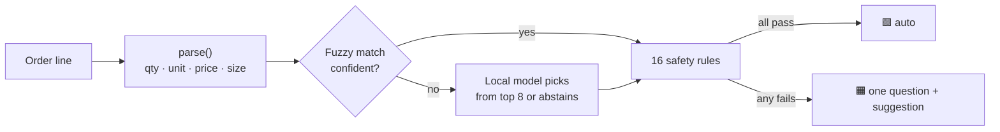

# ParchiMatch Lite

**Messy wholesale orders → clean billing rows, on the shop's own computer.**

A small FMCG wholesaler gets orders like these on WhatsApp:

```text
Namaste bhaiya
parle g 5/- 2 petti
tata namak 1 kg 5 ctn, lays hara 10 rs 3 box
पारले जी 5 वाला 2 पेटी
fortune oil 2
Kal subah tak bhej dena
```

Someone retypes every line into Tally, Busy or Marg. ParchiMatch Lite reads each line, matches it to the shop's own catalogue, and **either fills in a checked row or asks one short question**. It never guesses a number, and it never auto-accepts a row it can't justify. It runs fully offline with an open-weight model on an 8 GB laptop.

| | |
|---|---|
| 🟩 **Green** | Matched and checked: `parle g 5/- 2 petti` → 2 cartons Parle-G ₹5 (288 packets) |
| 🟧 **Amber** | One question, best guess pre-filled: `marie 30 wala 20 jodi` → *What is "jodi"? packet or carton?* |
| ⬜ **Grey** | Greetings and notes, ignored: `Kal subah tak bhej dena` |

## Highlights

- **Safety first.** Code reads every quantity, unit, price and pack size. The local model only picks *which product*, and 16 rules check its pick ([RULES.md](docs/RULES.md)). On the locked synthetic test, no method let a wrong row through.
- **Hybrid matching.** Fuzzy text matching handles most lines instantly. The model (Gemma 4 E2B via Ollama, chosen in a [5-model bake-off](docs/EVALUATION.md#model-bake-off)) is asked only when fuzzy can't name the product: 31 of 80 test lines, about 2 s each.
- **Learns the shop's shorthand.** Correct "lais peela" once, tick *Remember*, and it matches automatically next time. No training needed.
- **Hinglish and Devanagari.** `petti`, `darjan`, `nag`, `bora`, `do petti`, `5 wala`, `10 ka`, `पारले जी 5 वाला 2 पेटी`.
- **Private by construction.** Binds to 127.0.0.1, has no cloud calls, and every file is a CSV on the shop's disk.
- **Zero dependencies.** TypeScript run directly by Node 24, `node:http`, plain HTML/JS. Nothing to `npm install`.
- **Measured, not claimed.** An evaluation harness, a locked held-out test set, a leak check, and a seeded synthetic benchmark.

## Results (locked synthetic test, 80 lines)

| Method | Handled with no review | Wrong rows auto-accepted | No typing needed* | Model calls |
|---|---:|---:|---:|---:|
| Exact match | 54.9% | 0 | 54.9% | 0 |
| Fuzzy match | 84.3% | 0 | 84.3% | 0 |
| Model on every line | 84.3% | 0 | 92.2% | 80 |
| **Hybrid (the app)** | **88.2%** | **0** | **92.2%** | **31** |

\*Automatic, or one tap to confirm a correct pre-filled suggestion. Model `gemma4:e2b-it-qat`, MacBook Air M2, 8 GB, current code (after the [external test pass](docs/TEST_REPORT.md)). The data is **synthetic**; read the [data card](data/synthetic/DATA_CARD.md) and [EVALUATION.md](docs/EVALUATION.md) before quoting these.

## Quick start

**Requirements:** Node.js 24+, and for the model: [Ollama](https://ollama.com) plus about 6 GB of disk (the model is a 4.3 GB download). Without Ollama, the app runs fuzzy matching only.

```bash
brew install node ollama && brew services start ollama
```
```bash
ollama pull gemma4:e2b-it-qat
```
```bash
git clone https://github.com/bipul724/parchimatch.git && cd parchimatch
```
```bash
npm test
```
```bash
npm run app -- --open
```

It checks Node, Ollama and the model (printing the `ollama pull` command if the model is missing; it never downloads anything), starts the app, and opens <http://127.0.0.1:5178>. Without Ollama it starts with fuzzy matching only. Pick **Sample order 03** and click **Match order**. Confirm or skip the amber lines, then **Export CSV**. The file is also saved in `data/app/exports/`.

Full setup, auto-start and offline checks: [DEPLOY.md](docs/DEPLOY.md).

## How it works



Details: [ARCHITECTURE.md](docs/ARCHITECTURE.md). Why it's built this way, including the experiment where the model alone was *worse* than fuzzy matching: [DESIGN.md](docs/DESIGN.md).

## Evaluate

```bash
npm run eval -- --catalog data/synthetic/catalog.csv --cases data/synthetic/test.jsonl --methods exact,fuzzy,hybrid,llm-cand --label my-run
```

Results go to `results/` (every row with reasons, a per-tag breakdown, and a running `summary.md`). To evaluate on a real shop's data, lock a test set first: [EVALUATION.md](docs/EVALUATION.md).

To label order lines written by other people for a human-written test set, first save the lines in `data/human/raw.txt`, one order line per line, then run:

```bash
npm run label -- --catalog data/synthetic/catalog.csv --in data/human/raw.txt --out data/human/labelled.jsonl
```

For each line it shows the parsed quantity and unit and eight candidate products, sorted by name and without scores, then asks for the product (a number from the list or any SKU), quantity, unit, whether a careful person could enter it without asking (y or n, no default), and tags. It saves after every line and continues where it stopped. It refuses to write into `data/synthetic/` or a locked file.

## Documentation

| Doc | Contents |
|---|---|
| [docs/ARCHITECTURE.md](docs/ARCHITECTURE.md) | Components, pipeline, request flow, state, performance, failure behaviour |
| [docs/DESIGN.md](docs/DESIGN.md) | Decisions with evidence, UX principles, limitations |
| [docs/RULES.md](docs/RULES.md) | Safety rules, learned-name rules, parser rules, project rules |
| [docs/API.md](docs/API.md) | HTTP endpoints, request/response shapes, server flags |
| [docs/DATA_FORMATS.md](docs/DATA_FORMATS.md) | Catalogue CSV, labelled JSONL, learned names, export CSV, results |
| [docs/EVALUATION.md](docs/EVALUATION.md) | Metrics, protocol, results, fine-tuning gate |
| [docs/DEPLOY.md](docs/DEPLOY.md) | Install, run, real-shop setup, auto-start, offline check, backups |
| [docs/TROUBLESHOOTING.md](docs/TROUBLESHOOTING.md) | Common problems and fixes |
| [docs/TEST_REPORT.md](docs/TEST_REPORT.md) | External test audit: 25 fixed findings, open behaviours, adversarial safety run, follow-up review |
| [docs/MANUAL_TEST_CHECKLIST.md](docs/MANUAL_TEST_CHECKLIST.md) | Browser click-through checklist |
| [data/synthetic/DATA_CARD.md](data/synthetic/DATA_CARD.md) | How the synthetic data was made and its limits |
| [SPEC.md](SPEC.md) | Original build spec and schedule |
| [CONTRIBUTING.md](CONTRIBUTING.md) | Code conventions and how to add things |
| [SECURITY.md](SECURITY.md) | Privacy model, threat model, known issues |
| [TESTING_PROMPT.md](TESTING_PROMPT.md) | Brief for an external end-to-end test pass |

## Project layout

```
app/            review UI (HTML, CSS, JS; no build)
src/            server, pipeline, harness (TypeScript, run directly by Node 24)
tools/          synthetic data generator
data/fixture/   40 hand-written development lines
data/synthetic/ 111-item catalogue, 320 dev + 80 locked test lines, 8 demo orders
test/           node:test suites
docs/           documentation
```

Gitignored, because they may hold shop data: `data/real/`, `data/app/`, `data/train/`, `results/`.

## Status and limitations

- Evaluated on **synthetic** data only. No real shop has used it yet.
- One shop, one operator, one order at a time. Pasted text only: no photos, voice or WhatsApp integration.
- A comma inside an item's description splits it into two rows ("maggi, 4 pack 1 ctn"). Commas inside numbers ("1,500 bag", "1,00,000") are kept and read; unclear ones ("1,5") are asked about.
- Known security items to fix are listed in [SECURITY.md](SECURITY.md#known-issues).

## License

[MIT](LICENSE)
