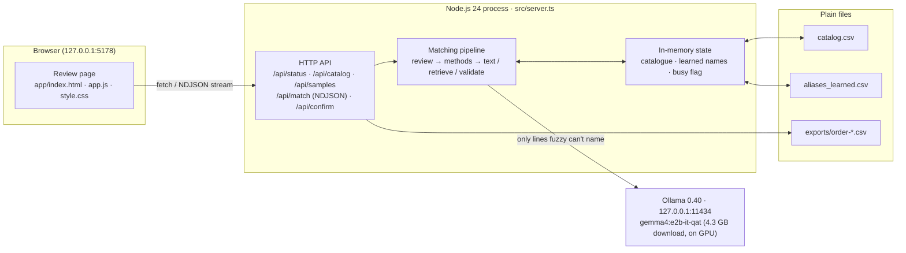
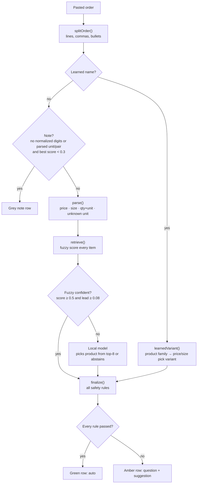
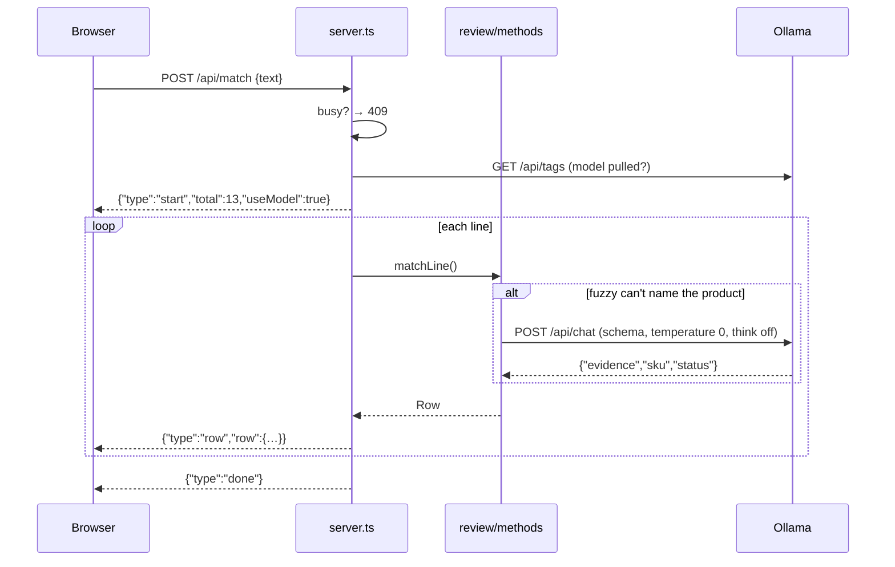

# Architecture

ParchiMatch Lite is a single local process: a Node.js HTTP server that serves a plain web page and runs the matching pipeline. A local language model (Gemma 4 E2B in Ollama) is called only for lines that plain text matching can't resolve. Nothing leaves the machine.

## System overview



## The matching pipeline

Every order line goes through the same steps, in the app and in the evaluation harness.



| Step | Module | Owns |
|---|---|---|
| Split | `src/orderlines.ts` | One candidate item per line or comma-separated part |
| Parse | `src/text.ts` | Every number: quantity, unit, price (MRP) hint, pack-size hint, unknown unit words. Hinglish, Hindi number words and Devanagari |
| Retrieve | `src/retrieve.ts` | Fuzzy scores (trigram Jaccard + word cover, ±0.15 price/size boosts) and exact alias matches |
| Decide | `src/methods.ts` | `exact`, `fuzzy`, `llm-full`, `llm-cand`, `hybrid`. The app uses `hybrid` (or `fuzzy` when the model is offline) |
| Model | `src/prompt.ts`, `src/llm.ts` | Prompt, JSON schema `{evidence, sku, status}`, one repair retry, think-mode fallback |
| Validate | `src/validate.ts` | All safety rules ([RULES.md](RULES.md)), resolving two-number lines, the operator's question, base-quantity conversion |
| Review | `src/review.ts` | Review rows, learned-name handling, server-side re-check of confirmed rows, CSV export |
| Learn | `src/learned.ts` | Append-only CSV of operator-taught names |

**The core principle:** the model is a *product picker*, never a number reader. It sees the order line, the price/size hints code already read, and up to eight candidates. It returns a SKU and whether it's sure. Code then decides whether that pick is safe to accept.

## Request lifecycle: matching an order



Rows stream as newline-delimited JSON, so the table fills while the model works. Only one order is matched at a time (`busy` flag). The model has one GPU and the Mac has 8 GB.

## State

| State | Where | Lifetime |
|---|---|---|
| Catalogue | In memory, loaded from `--catalog` (or the default path) on every start; uploads are saved to `<data>/catalog.csv` | Process; reloaded on upload. To restore an upload after restart, pass its saved path with `--catalog` |
| Learned names | In memory map + `data/app/aliases_learned.csv` (append-only; the last entry wins) | Persistent |
| Exports | `data/app/exports/order-<timestamp>-<unique-id>.csv` | Persistent; each export has its own filename |
| Review decisions | Browser memory only, until export | Page session |
| Model | Ollama, `keep_alive` 15 minutes | Unloads after 15 idle minutes |

There's no database. Every persistent artefact is a CSV a shopkeeper could open.

## Repository layout

```
parchimatch/
├── app/                    review UI (static, no build)
├── src/
│   ├── server.ts           HTTP server and API
│   ├── review.ts           rows, learned names, export
│   ├── methods.ts          exact / fuzzy / llm-full / llm-cand / hybrid
│   ├── text.ts             normalise + parse (all numbers)
│   ├── retrieve.ts         fuzzy scoring, exact matches
│   ├── validate.ts         safety rules, questions, base quantities
│   ├── prompt.ts, llm.ts   model prompt and Ollama client
│   ├── catalog.ts          catalogue CSV loading and validation
│   ├── learned.ts          learned-names CSV
│   ├── orderlines.ts       order splitting
│   ├── eval.ts             evaluation harness
│   ├── split.ts            lock a held-out test set
│   ├── checkleak.ts        near-duplicate check
│   ├── exporttrain.ts      fine-tuning data export
│   ├── types.ts, util.ts   shared types and helpers
├── tools/gen-synthetic.ts  seeded synthetic data generator
├── data/
│   ├── fixture/            40 hand-written lines (development)
│   ├── synthetic/          111-item catalogue, 320 dev + 80 locked test lines, 8 demo orders
│   ├── app/                runtime: learned names, uploads, exports (gitignored)
│   └── real/               a real shop's data, if any (gitignored)
├── test/                   node:test suites
├── results/                evaluation outputs (gitignored)
└── docs/                   this documentation
```

## Performance (measured on a MacBook Air M2, 8 GB)

| Measure | Value |
|---|---|
| Model load (cold) | ~15 s |
| Model call, `hybrid`, locked synthetic test (Gemma 4 E2B) | p50 2.2 s, p95 2.8 s |
| Model call on every line (`llm-cand`, Gemma 4 E2B) | p50 2.2 s, p95 2.6 s |
| Model calls needed by `hybrid` | 31 of 80 test lines |
| Sample order 03, 13 lines, first run (previous model, Qwen3.5-4B) | 28.8 s |
| Same order after learning two names (previous model) | 5.3 s |
| Fuzzy / exact matching | well under 1 ms per line |
| Model resident size (Gemma 4 E2B) | ≈3.6 GB, fully on GPU |

Latency rises sharply when macOS swaps. Close other apps before demos and measurements.

## Failure behaviour

| Failure | Behaviour |
|---|---|
| Ollama not running / model not pulled | App runs fuzzy-only; status chip says "Model offline". The harness skips model methods |
| Model returns invalid JSON | One repair retry; if still invalid, the line becomes amber with the reason |
| Model errors (HTTP 500, timeouts) | Line becomes amber; the server keeps running |
| Model picks a product it wasn't shown, or one the catalogue lacks | Rejected by `finalize()` |
| Invalid catalogue upload | 400 with row-level errors; the previous catalogue stays active |
| Second order while one is matching | 409 |
